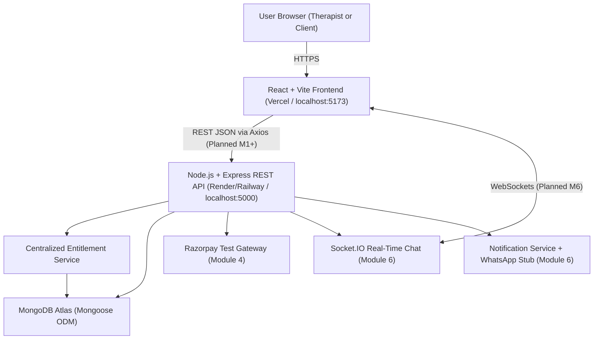
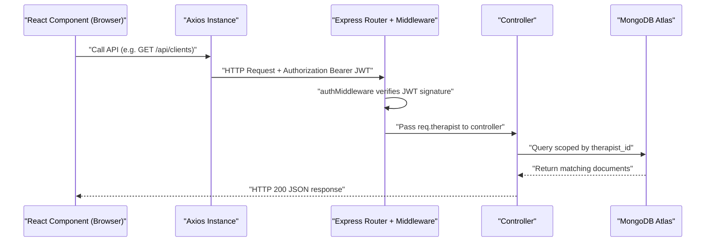
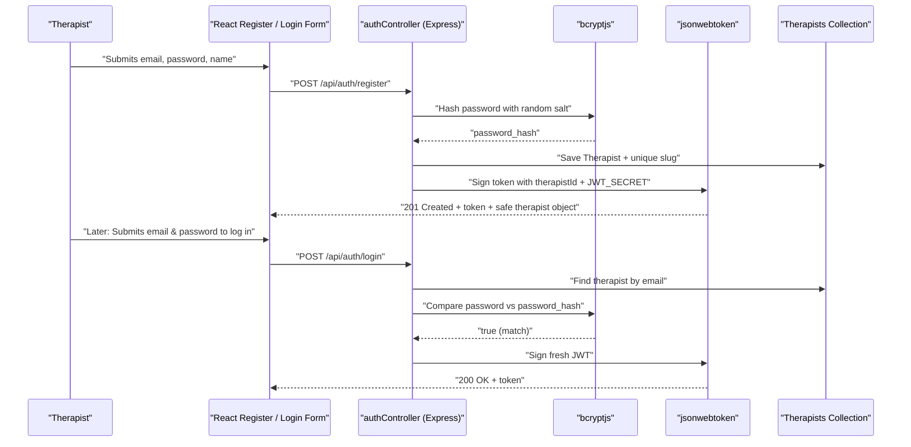
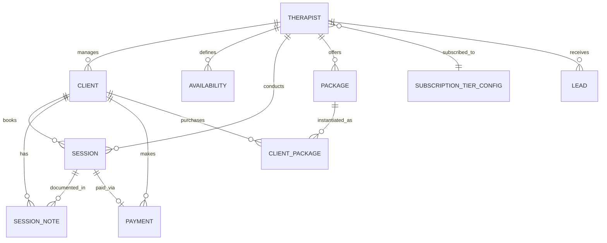
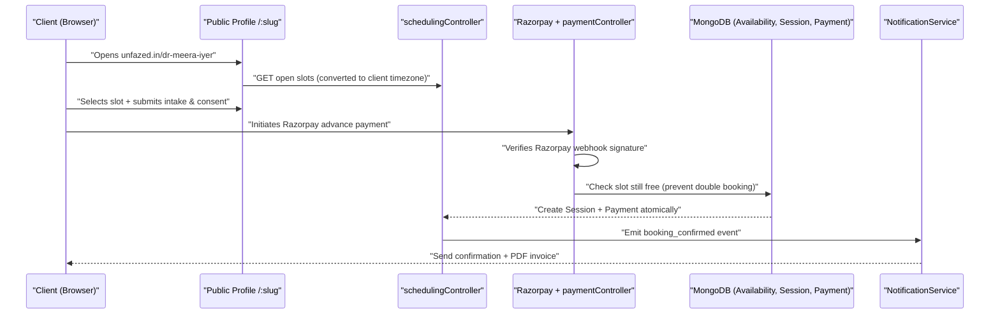

# UNFAZZED — Complete Project & Interview Guide

> **Audience:** Beginner Developer / Second-Year CS Student preparing for Software Engineering Internships  
> **Project:** UNFAZZED — Therapist Practice Management SaaS (India)  
> **Source of Truth:** [`UNFAZZED_SPEC.md`](./UNFAZZED_SPEC.md) + Actual Workspace Inspection  
> **Important Honesty Rule:** Never claim a planned feature is already built. This guide strictly separates **Implemented (Phase 1)** from **Planned (Modules 1–7)**.

---

## Current Project Implementation Status (At a Glance)

| Area | Status | What Exists Right Now |
| :--- | :--- | :--- |
| **Phase 1 — Design System & Public Landing Page** | **Implemented** | `unfazed-frontend/` built with React 19, Vite 6, React Router 7, Tailwind CSS v4, design tokens, reusable UI primitives, 10-section Squarespace-inspired landing page, bespoke Indian studio SVG artwork, interactive workspace preview UI, and `/login` + `/register` placeholder pages. Production `vite build` passes. |
| **Module 1 — Backend, Auth, Profile & `/:slug`** | **Next / Not Yet Built** | `unfazed-backend/` folder does not exist yet. No Express server, MongoDB Atlas connection, `Therapist` model, JWT auth, or `/:slug` dynamic backend route yet. |
| **Modules 2–7 — Scheduling, CRM, Payments, Notes, Chat, Entitlements & Analytics** | **Planned** | Fully specified in `UNFAZZED_SPEC.md`, ready to be built sequentially after Phase 1. |

---

## Table of Contents

1. [Project Introduction](#1-project-introduction)
2. [Complete Technology Stack](#2-complete-technology-stack)
3. [Complete Project Architecture](#3-complete-project-architecture)
4. [Complete Folder and File Explanation](#4-complete-folder-and-file-explanation)
5. [Database Deep Dive](#5-database-deep-dive)
6. [Complete Module-by-Module Explanation](#6-complete-module-by-module-explanation)
7. [API Documentation](#7-api-documentation)
8. [Authentication and Security Deep Dive](#8-authentication-and-security-deep-dive)
9. [Complete User Workflows](#9-complete-user-workflows)
10. [Code Understanding and Programming Fundamentals](#10-code-understanding-and-programming-fundamentals)
11. [Testing and Debugging](#11-testing-and-debugging)
12. [Deployment and Git](#12-deployment-and-git)
13. [Technical Interview Questions (100 Questions)](#13-technical-interview-questions)
14. [Project Explanation for Resume and Interviews](#14-project-explanation-for-resume-and-interviews)
15. [Interview Preparation Roadmap](#15-interview-preparation-roadmap)

---

## 1. Project Introduction

### What is UNFAZZED?
**UNFAZZED** is a full-stack **Therapist Practice Management SaaS** (Software as a Service) web application designed specifically for independent therapists, psychologists, counsellors, and mental wellness professionals in India.

Its goal is to give a solo mental health practitioner one calm, structured system to run their entire private practice—from a shareable public booking link (like `unfazed.in/dr-sharma`) all the way to appointment scheduling, client intake, payments, confidential clinical notes, client messaging, and practice analytics.

### What is SaaS? (Beginner Explanation)
**SaaS** stands for **Software as a Service**.
* **Traditional software:** You buy a CD or download an `.exe` file, install it on one laptop, and manage updates yourself.
* **SaaS:** The software runs on cloud servers and is delivered through a web browser (just like Notion, Google Docs, or Zoho). Users log in from anywhere, and instead of buying the software once, practitioners subscribe to tiers (for example, Starter vs. Growth) that unlock features or capacity limits.

In UNFAZZED, therapists don't install software or hire a web developer. They sign up on one multi-tenant platform, customize their profile, and get their own branded URL (`unfazed.in/<slug>`) plus a private practice dashboard.

### What Real-World Problem Does It Solve?
Independent therapists in India usually manage their practice using **5 to 7 disconnected tools**:
1. An Instagram bio or Linktree for discovery.
2. WhatsApp messages for back-and-forth slot negotiation (*"Are you free Thursday at 5?"*).
3. Google Calendar without automatic buffer times or timezone conversion for NRI/remote clients.
4. Manual UPI screenshots for fee tracking and no proper GST-style receipts.
5. Google Docs or paper notebooks for session notes—which makes it risky or messy to share takeaways with clients while keeping clinical observations strictly private.

This creates administrative exhaustion, missed follow-ups, double bookings, awkward payment chasing, and privacy risks. **UNFAZZED brings all of those workflows into one dedicated system.**

### Who Are Its Users?
1. **Primary User 1 — Therapists / Mental Wellness Practitioners:** Manage availability, client records, intake forms, clinical documentation, packages, invoices, and practice analytics inside the **Therapist Dashboard**.
2. **Primary User 2 — Clients (Patients):** Visit the therapist's branded public link, learn about their approach, fill out intake and digital consent, book and pay for sessions or packages, view **shared** notes, and message their therapist inside the **Client Portal**.

### What Makes UNFAZZED Different From a Simple Appointment-Booking Website?
A generic booking site (like Calendly) only picks a date and time. UNFAZZED goes much deeper:
* **Clinical Privacy Boundary:** Enforces strict backend API separation between `private` therapist notes and `shared` client takeaways.
* **End-to-End Care Lifecycle:** Connects discovery (`/:slug`) -> intake & timestamped consent -> scheduling (buffer + timezone conversion) -> Razorpay INR payments & 3/6/12-session packages -> GST-style PDF invoices -> clinical notes -> real-time Socket.IO chat.
* **Centralized Entitlements:** Uses a config-driven `SubscriptionTierConfig` and a single `EntitlementService.canAccess(therapistId, featureKey)` service rather than hardcoding subscription rules everywhere.
* **Real Server-Side Analytics:** Computes revenue trends, active clients, and no-show rates with MongoDB aggregation pipelines rather than dumping raw records to the browser.

### Major Features (From `UNFAZZED_SPEC.md`)
1. **Module 1 (Planned next):** Therapist authentication (JWT + bcrypt), profile management, and branded public profile (`/:slug` + Open Graph tags). *(Phase 1 public landing page & design system are already implemented.)*
2. **Module 2 (Planned):** Recurring weekly availability, overrides, blocked slots, buffer times, 30/45/60/90-min durations, client timezone conversion, and double-booking prevention.
3. **Module 3 (Planned):** Therapist-scoped Client CRM, sortable/filterable client directory, intake form, and auditable timestamped digital consent.
4. **Module 4 (Planned):** Razorpay advance payments, webhook signature verification, 3/6/12-session packages with expiry tracking, and PDFKit GST-style invoices.
5. **Module 5 (Planned):** TipTap rich-text clinical notes with API-enforced `private` vs. `shared` visibility separation.
6. **Module 6 (Planned):** Socket.IO real-time therapist-client chat and an event-driven `NotificationService` (booking confirmation, 24h reminder, follow-up, WhatsApp stub/queue).
7. **Module 7 (Planned):** Config-driven subscription tiers, centralized `EntitlementService`, upgrade prompts, and MongoDB aggregation analytics visualized with Recharts.

### A Simple Real-World Example
Imagine **Dr. Meera Iyer**, a counselling psychologist in Bengaluru:
* **Before UNFAZZED:** A new client messages her on Instagram, asks about fees, transfers ₹1,800 via UPI, sends a screenshot on WhatsApp, forgets the session time across timezones, and Dr. Meera manually tracks everything in Excel.
* **With UNFAZZED:** Dr. Meera shares `unfazed.in/dr-meera-iyer`. The client reads her bio and languages, picks a 60-minute slot shown in the client's own timezone, completes intake + digital consent, and pays via Razorpay (receiving a PDF invoice). Dr. Meera writes a `private` clinical note (which the client's API can never read) and a `shared` grounding exercise (which appears in the client portal).

### Elevator Pitches (Ready to Speak in Interviews)

#### 30-Second Explanation
> "UNFAZZED is a SaaS platform I'm building with the MERN stack for independent therapists in India. It unifies a therapist's branded booking link, timezone-aware scheduling, digital intake and consent, Razorpay session packages, private-versus-shared clinical notes, real-time chat, and analytics in one place. So far, I've completed Phase 1—the frontend design system and public marketing website in React, Vite, and Tailwind CSS—and I'm following a 7-module architecture spec to build the Express and MongoDB backend next."

#### 1-Minute Explanation
> "Independent therapists in India often juggle WhatsApp, Google Calendar, UPI screenshots, and scattered documents to run their practice. UNFAZZED solves that by providing two connected experiences on top of one Node.js, Express, and MongoDB backend: a Therapist Dashboard for managing schedules, clients, billing, and notes, and a Client Portal behind a branded link like `unfazed.in/dr-sharma`. What makes it architecturally interesting is strict API-level separation between private clinical notes and shared client summaries, double-booking prevention across timezones, webhook-verified Razorpay payments with PDF invoices, and a centralized entitlement service for subscription tiers. Right now, the Phase 1 React + Tailwind frontend foundation and landing page are built and verified, and Modules 1 through 7 are structured sequentially in `UNFAZZED_SPEC.md`."

#### 2-Minute Technical Explanation
> "UNFAZZED is a three-tier MERN SaaS application designed around seven dependency-ordered modules. On the frontend, we use React 19, Vite, React Router, and Tailwind CSS v4—which I have already implemented for Phase 1 with a custom token system, responsive layout primitives, and an interactive dashboard preview. As we implement Modules 1 through 7, the frontend integrates Axios for REST APIs, `react-big-calendar` and `date-fns-tz` for timezone-aware booking, `react-hook-form` for intake, TipTap for rich-text notes, Socket.IO Client for real-time chat, and Recharts for analytics.
>
> On the backend—which is planned for Modules 1 to 7—we use Node.js, Express, and Mongoose with MongoDB Atlas, structured cleanly into routes, controllers, middleware, and isolated service modules. Key engineering decisions include: hashing passwords with `bcryptjs` and securing routes with JWTs; scoping every client, session, and note query to the authenticated `therapist_id`; enforcing `private` vs. `shared` clinical note visibility at the backend API and serializer layer rather than hiding fields in React; verifying Razorpay webhooks cryptographically before marking payments paid; centralizing feature gating inside a single `EntitlementService.canAccess(therapistId, featureKey)` backed by a `SubscriptionTierConfig` collection; and computing revenue, active clients, and no-show rates via MongoDB aggregation pipelines."

---

## 2. Complete Technology Stack

Below is every technology in the UNFAZZED stack, clearly marked as **Currently Used (Phase 1)** or **Planned (Modules 1–7)**.

### A. Frontend Technologies

#### 1. HTML (`index.html`) — *Currently Used (Phase 1)*
* **What is it?** HyperText Markup Language; the skeleton document that the browser loads first.
* **Why do we need it?** Every React app still needs one real HTML entry page with `<div id="root"></div>`, page `<title>`, Google Fonts links, and Open Graph `<meta>` tags.
* **What problem does it solve?** Tells browsers and link-preview crawlers (WhatsApp, LinkedIn) what the page is, loads fonts, and loads `src/main.jsx`.
* **How it works:** Browser downloads `unfazed-frontend/index.html`, loads the Google Fonts stylesheet, creates `<div id="root">`, and executes `/src/main.jsx` as an ES module.
* **Where used in UNFAZZED:** `unfazed-frontend/index.html`.
* **What happens without it:** Vite cannot serve or bundle the Single Page Application (SPA); there is no DOM mount point for React.

#### 2. CSS (`tokens.css`, `index.css`) — *Currently Used (Phase 1)*
* **What is it?** Cascading Style Sheets; controls colors, fonts, spacing, borders, animations, and responsive layout.
* **Why do we need it?** Defines the UNFAZZED brand palette (`#F8F7F3` warm off-white, `#242522` charcoal, `#52644F` forest green), CSS variables, and reduced-motion accessibility rules.
* **How it works:** `tokens.css` defines custom properties (`:root { --bg-canvas: #F8F7F3; ... }`), and `index.css` imports Tailwind CSS v4 plus `@theme` tokens and scroll-reveal helper classes (`.reveal-base`, `.reveal-visible`).
* **Where used in UNFAZZED:** `unfazed-frontend/src/styles/tokens.css`, `unfazed-frontend/src/index.css`.
* **What happens without it:** The site collapses into unstyled default browser Times New Roman links and loses all visual hierarchy and accessibility media queries.

#### 3. JavaScript (ES6+ / `.jsx`) — *Currently Used (Phase 1)*
* **What is it?** The programming language of the web browser (and Node.js on the server).
* **Why do we need it?** Powers UI interactivity (tabs, mobile drawer, horizontal showcase scrolling, scroll-reveal observer) and will power API requests, form validation, and state management.
* **Where used in UNFAZZED:** Every `.js` and `.jsx` file under `unfazed-frontend/src/`.
* **What happens without it:** Pages are completely static; buttons, tabs, mobile navigation, and routing cannot work.

#### 4. React (`react`, `react-dom` v19) — *Currently Used (Phase 1)*
* **What is it?** A component-based UI library that builds user interfaces as reusable JavaScript functions returning JSX.
* **Why do we need it?** A SaaS platform has dozens of interactive views (tabs, forms, calendars, tables, chat). Managing all of that with raw `document.createElement` and `innerHTML` quickly becomes buggy and unreadable.
* **What problem does it solve?** Splits complex pages into modular, testable components (`Navbar`, `Button`, `HeroSection`, `ProductExperienceSection`) and updates the DOM efficiently via state changes.
* **How it works:** Components accept `props`, hold local `state` (`useState`), and react to lifecycle events (`useEffect`). When state updates (e.g., clicking a tab in `ProductExperienceSection`), React reconciles changes cleanly.
* **Where used in UNFAZZED:** All components and pages in `unfazed-frontend/src/`.
* **What happens without it:** We would have to manually synchronize DOM elements on every click, route transition, and API update.

#### 5. React Router (`react-router-dom` v7) — *Currently Used (Phase 1)*
* **What is it?** Client-side routing library for React Single Page Applications.
* **Why do we need it?** Maps URL paths (`/`, `/login`, `/register`, and later `/:slug`, `/dashboard/*`) to React components **without full browser page reloads**.
* **How it works:** `<BrowserRouter>` listens to browser history/URL changes and `<Routes>` matches the URL against `<Route>` definitions in `src/routes/AppRoutes.jsx`. `<Link>` updates the URL smoothly via the History API.
* **Where used in UNFAZZED:** `unfazed-frontend/src/routes/AppRoutes.jsx`, `Navbar.jsx`, `Footer.jsx`, `Button.jsx`, `AuthPlaceholderPage.jsx`.
* **What happens without it:** Every navigation click reloads the whole page from scratch (losing React state), or multi-page routing becomes manual `window.location` hacks.

#### 6. Vite (`vite`, `@vitejs/plugin-react` v6) — *Currently Used (Phase 1)*
* **What is it?** A modern frontend development server and production bundler.
* **Why do we need it?** Browsers cannot natively understand `.jsx` syntax or Tailwind v4 `@theme` directives without compilation, and development needs fast hot-reloading.
* **How it works:** In dev (`npm run dev`), Vite serves native ES modules directly with instant Hot Module Replacement (HMR). In production (`npm run build`), Rollup bundles, tree-shakes, and minifies HTML/CSS/JS into `dist/`.
* **Where used in UNFAZZED:** `unfazed-frontend/vite.config.js`, `package.json` scripts.
* **What happens without it:** JSX files fail in the browser, Tailwind CSS won't compile, and production assets aren't optimized.

#### 7. Tailwind CSS (`tailwindcss`, `@tailwindcss/vite` v4) — *Currently Used (Phase 1)*
* **What is it?** A utility-first CSS framework (`flex`, `py-20`, `text-[#242522]`).
* **Why do we need it?** Lets us build bespoke editorial layouts quickly with consistent spacing and responsive breakpoints (`sm:`, `md:`, `lg:`) while keeping CSS bundle size tiny (only classes actually used are emitted—`30.58 kB` uncompressed / `6.49 kB` gzipped in our Phase 1 build).
* **Where used in UNFAZZED:** Every component in `unfazed-frontend/src/`, configured via `@tailwindcss/vite` in `vite.config.js` and `@import "tailwindcss";` in `src/index.css`.
* **What happens without it:** We would have to write and maintain thousands of lines of custom CSS class names and media queries across 20+ files.

#### 8. Axios (`axios`) — *Planned (Module 1+)*
* **What is it?** A promise-based HTTP client for making REST API calls (`GET`, `POST`, `PUT`, `PATCH`, `DELETE`) from React to Express.
* **Why do we need it (over native `fetch`)?** Supports a centralized `axiosInstance` (`baseURL` from `VITE_API_BASE_URL`), request interceptors (automatically attaching the `Authorization: Bearer <token>` JWT header), response interceptors (handling `401 Unauthorized` globally), and automatic JSON parsing.
* **Where planned:** `unfazed-frontend/src/api/axiosInstance.js` starting in Module 1.

#### 9. Additional Planned Frontend Libraries (`UNFAZZED_SPEC.md`)
* **`react-hook-form` (Module 3):** Performant form state and validation for client intake and therapist profile forms.
* **`date-fns`, `date-fns-tz`, `react-big-calendar` (Module 2):** Timezone-aware slot conversion (e.g., IST to client's local timezone) and therapist scheduling calendar.
* **`@tiptap/react`, `@tiptap/starter-kit` (Module 5):** Rich-text editor for structured/freeform session notes.
* **`socket.io-client` (Module 6):** Real-time WebSocket chat client.
* **`recharts` (Module 7):** Responsive React charts for revenue trends and practice metrics.

---

### B. Backend Technologies *(All Planned — Modules 1–7)*

> **Note:** None of the backend packages below are installed yet because `unfazed-backend/` begins in Module 1.

#### 1. Node.js (v18+; `v24.20.0` installed locally)
* **What is it?** A JavaScript runtime built on Chrome's V8 engine that lets JavaScript run outside the browser on a server.
* **Why do we need it?** Runs our Express API server, connects to MongoDB Atlas, handles auth, payments, PDFs, and WebSockets—allowing full-stack JavaScript across frontend and backend.
* **What happens without it:** We could not run JavaScript server-side and would need another backend language (Python, Java, Go).

#### 2. Express.js (`express`)
* **What is it?** A minimal, flexible web framework for Node.js.
* **Why do we need it?** Simplifies routing (`app.use('/api/auth', ...)`), JSON body parsing (`express.json()`), middleware chaining, and centralized error handling.
* **What happens without it:** Writing raw `http.createServer` code to parse URLs, headers, request streams, and route parameters manually is error-prone and verbose.

#### 3. REST APIs
* **What is it?** Representational State Transfer—a convention for exposing backend resources (`/api/clients`, `/api/sessions`) over standard HTTP verbs (`GET`, `POST`, `PUT`, `PATCH`, `DELETE`) returning JSON.
* **Why do we need it?** Gives the React frontend (and tools like Postman) a clean, stateless contract to talk to the backend.

#### 4. MongoDB (MongoDB Atlas)
* **What is it?** A NoSQL document database storing JSON-like BSON documents in collections instead of rigid SQL tables.
* **Why do we need it?** Practice data like flexible intake responses, therapist specializations/languages arrays, recurring availability overrides, and rich-text clinical notes fit naturally into documents, and MongoDB Atlas hosts it cleanly in the cloud.
* **What happens without it:** Data lives only in server RAM and vanishes every time the server restarts.

#### 5. Mongoose (`mongoose`)
* **What is it?** An Object Data Modeling (ODM) library for MongoDB in Node.js.
* **Why do we need it?** MongoDB itself is schemaless; Mongoose enforces structure, data types, required fields, `ref` relationships (`therapist_id`), validation, and clean aggregation queries.

#### 6. JWT (`jsonwebtoken`)
* **What is it?** JSON Web Token—a cryptographically signed compact token (`header.payload.signature`) used for stateless authentication.
* **Why do we need it?** After login, the server issues a signed token containing the therapist's ID. Every protected request sends it in the `Authorization: Bearer <token>` header so the server knows who is calling without storing session state in memory.

#### 7. bcrypt (`bcryptjs`)
* **What is it?** A password-hashing algorithm with built-in random salting and configurable work factor (cost).
* **Why do we need it?** **Never store plaintext passwords.** Even if a database backup leaks, salted bcrypt hashes cannot be reversed back to real passwords, and per-user salts defeat rainbow-table attacks.

#### 8. Middleware
* **What is it?** Functions `(req, res, next)` that sit between an incoming HTTP request and the final route controller.
* **Where planned:** `authMiddleware.js` (verifies JWT and attaches `req.therapist`), `entitlementMiddleware.js` (checks `EntitlementService.canAccess`), `errorHandler.js` (centralized JSON error formatting), plus `cors` and `express.json()`.

#### 9. `express-validator`
* **What is it?** Express middleware for validating and sanitizing incoming request bodies, params, and query strings (e.g., valid email, strong password, allowed session durations `30|45|60|90`).
* **What happens without it:** Malformed data, missing fields, or unexpected types reach controllers and database models directly.

---

### C. Other Technologies & Tooling

| Technology | Status | What It Is & Role in UNFAZZED |
| :--- | :--- | :--- |
| **Git & GitHub** | **Git active locally** (`master`, commit `49a006f`); GitHub planned | Version control tracking history; `UNFAZZED_SPEC.md` specifies module-by-module branches (`module-1-foundations` ... `module-7-entitlements-analytics`). |
| **Environment Variables (`.env`, `.env.example`)** | **`.env.example` created in frontend**; backend `.env` planned | Keeps secrets (`MONGO_URI`, `JWT_SECRET`, `RAZORPAY_KEY_SECRET`) out of Git while sharing safe placeholder templates. |
| **Postman** | **Planned (Module 1+)** | API client used to test backend endpoints, headers, JWT flows, and error status codes before/alongside wiring React. |
| **Razorpay** | **Planned (Module 4)** | Indian payment gateway (test mode) for advance session/package checkout + server-side webhook signature verification (`HMAC-SHA256`). |
| **PDFKit (`pdfkit`)** | **Planned (Module 4)** | Node.js library to generate downloadable GST-style PDF invoices after verified payment. |
| **Socket.IO (`socket.io`)** | **Planned (Module 6)** | Bi-directional real-time communication for therapist-client in-app chat rooms. |
| **Nodemailer (`nodemailer`)** | **Optional / Planned (Module 6)** | Email notification delivery inside `NotificationService` (alongside a WhatsApp stub/queue). |
| **Deployment (Vercel, Render/Railway, MongoDB Atlas)** | **Planned (Incremental from Module 1)** | Cloud hosting: React static bundle on Vercel, Node/Express API on Render/Railway, database on MongoDB Atlas. |

---

## 3. Complete Project Architecture

### Overview
UNFAZZED uses a **Three-Tier Architecture** (from `UNFAZZED_SPEC.md` Section 2):
1. **Presentation Tier (Frontend — React + Vite):** Two distinct experiences sharing one brand system:
   * Public Marketing Website *(Implemented in Phase 1)* + Branded Public Therapist Page `/:slug` *(Planned Module 1)* + Client Portal *(Planned Modules 2–6)*
   * Authenticated Therapist Dashboard *(Planned Modules 1–7; currently previewed interactively in `ProductExperienceSection.jsx`)*
2. **Application Tier (Backend — Node.js + Express, Planned):** Organized strictly into `routes -> middleware -> controllers -> services -> models`.
3. **Data Tier (Database — MongoDB Atlas + Mongoose, Planned):** Stores structured practice documents and runs aggregation pipelines for analytics.

### 1. Overall System Architecture



**Simple English explanation:** The user only ever opens the React website in their browser. Whenever data needs to be saved or fetched (in Modules 1–7), React asks the Express backend over HTTPS. Express checks authentication and subscription entitlements, talks to MongoDB Atlas, and coordinates payments, PDFs, notifications, and live chat behind isolated service files.

### 2. Frontend–Backend Communication Lifecycle *(Planned Module 1+)*



**Simple English explanation:** Instead of the browser talking directly to MongoDB (which would expose database credentials and let anyone read other therapists' patient data!), React calls an Express API endpoint. Express verifies the user's JWT badge, asks MongoDB only for records belonging to that therapist, and sends back clean JSON.

### 3. User Registration and Login Lifecycle *(Planned Module 1)*



**Simple English explanation:** On registration, we scramble the password one-way using `bcryptjs` before saving to MongoDB, and generate a unique URL slug. On login, `bcryptjs` checks whether the typed password matches the stored hash. If it matches, Express hands the browser a signed JWT passkey for future requests.

### 4. Database Relationships *(Planned Models from `UNFAZZED_SPEC.md`)*



**Simple English explanation:** The `THERAPIST` sits at the center of the practice. Every `CLIENT`, `AVAILABILITY`, `SESSION`, `PACKAGE`, and `LEAD` belongs to a specific `therapist_id`. A `SESSION` connects a therapist and a client, can link to a `PAYMENT`, and can have `SESSION_NOTE` records marked either `private` or `shared`.

### 5. Appointment Booking Workflow *(Planned Modules 2–4)*



**Simple English explanation:** When a client visits `/:slug`, slots are calculated from the therapist's availability minus existing bookings and buffer times, converted into the client's local timezone. Before finalizing a booking, the backend verifies the slot is still unclaimed (preventing two clients from booking the exact same time simultaneously) and verifies payment confirmation via Razorpay's server webhook.

### Protected Routes vs. Public Therapist Profile Lifecycle
* **Currently in Phase 1:** `AppRoutes.jsx` renders `/` (`LandingPage`), `/login` (`AuthPlaceholderPage`), `/register` (`AuthPlaceholderPage`), and redirects unknown paths (`*`) to `/`.
* **Planned in Module 1+:**
  * **Public route (`/:slug`):** Unauthenticated visitors load only public fields (`name`, `slug`, `bio`, `specializations`, `languages`, public session offerings)—never `password_hash`, private notes, or other clients.
  * **Protected routes (`/dashboard/*`):** Wrapped in a React `ProtectedRoute` component that checks `AuthContext` for a valid logged-in therapist, and every corresponding backend `/api/*` endpoint enforces `authMiddleware` so bypassing the React UI still gets `401 Unauthorized`.

---

## 4. Complete Folder and File Explanation

### 4.1 Actual Root Structure

  ```text
  unfazzed_project/
  ├── .gitignore
  ├── UNFAZZED_SPEC.md
  ├── UNFAZZED_INTERVIEW_GUIDE.md
  └── unfazed-frontend/
      ├── .env.example
      ├── .gitignore
      ├── index.html
      ├── package.json
      ├── vite.config.js
      ├── dist/
      └── src/
  ```

  There is currently no `unfazed-backend/` directory.

  ### 4.2 Root and Frontend Configuration

  | File | Responsibility | Important contents | If changed incorrectly |
  |---|---|---|---|
  | `.gitignore` | Protects the repository from generated or private files | Ignores `node_modules/`, `.env`, `.env.*`, `dist/`, `build/`, and coverage | Secrets or dependencies may be committed |
  | `UNFAZZED_SPEC.md` | Product requirements and module roadmap | Seven modules, data models, architecture, security, and delivery checklist | Scope becomes unclear or contradictory |
  | `UNFAZZED_INTERVIEW_GUIDE.md` | Interview and code documentation | This explanation | No application behavior changes |
  | `unfazed-frontend/package.json` | Dependencies and scripts | React 19, React DOM, React Router, Vite, Tailwind | Wrong dependencies/scripts can break install/build |
  | `vite.config.js` | Vite plugins | React plugin and Tailwind Vite plugin | JSX or Tailwind processing may fail |
  | `index.html` | Browser document shell | Root `<div>`, metadata, font links, `/src/main.jsx` script | React cannot mount or metadata is lost |
  | `.env.example` | Public frontend environment template | API base URL and public Razorpay key placeholder | Real secrets must never be added here |

  ### 4.3 Frontend Entry and Routing

  #### `src/main.jsx`

  - Imports `StrictMode`, `createRoot`, global CSS, and `App`.
  - Gets `#root` from `index.html` and mounts the React tree.
  - Deleting it or its mount call leaves the HTML document with an empty root.
  - Interview concept: React entry points mount a component tree into existing browser DOM.

  #### `src/App.jsx`

  - Imports `AppRoutes` and renders it.
  - It is a very small composition root.
  - This separation allows routing policy to remain outside the application shell.

  #### `src/routes/AppRoutes.jsx`

  - Uses `BrowserRouter`, `Routes`, `Route`, and `Navigate`.
  - `/` renders `LandingPage`.
  - `/login` and `/register` render `AuthPlaceholderPage` with different `mode` props.
  - Unknown paths redirect to `/`.
  - A deployed static host must return `index.html` for React Router paths instead of a server 404.

  #### `src/pages/LandingPage.jsx`

  - Composes the complete public landing page.
  - Imports all major landing sections and common layout components.
  - It contains no API or database operations.

  #### `src/pages/AuthPlaceholderPage.jsx`

  - Uses the `mode` prop to choose a login/register heading and description.
  - It is a visual placeholder that explicitly says Module 1 is upcoming.
  - It imports no auth API, bcrypt, JWT library, or auth context.
  - It must not be presented in an interview as working authentication.

  ### 4.4 Common Components

  #### `src/components/common/Button.jsx`

  - Centralizes four variant decisions, size decisions, focus styles, and disabled styles.
  - If `to` is present, returns React Router `<Link>`.
  - If `href` is present, returns an `<a>`.
  - Otherwise, returns a native `<button>`.
  - `...props` forwards handlers and attributes.
  - Deleting it affects most calls to feature/register buttons.

  #### `src/components/common/Container.jsx`

  - Applies the shared maximum width and responsive padding.
  - Accepts `as` to render as a custom element such as `section`.
  - It improves consistency but is not layout or business logic.

  #### `src/components/common/Navbar.jsx`

  - Stores `scrolled` and `mobileOpen` with `useState`.
  - `useEffect` listens to the scroll event and changes body overflow for the mobile drawer.
  - It cleans up listeners and body styles on unmount.
  - It maps `NAV_LINKS` for desktop and mobile.
  - Interview concept: effects implement browser side effects and require cleanup.

  #### `src/components/common/Footer.jsx`

  - Stores four static footer link columns.
  - Uses internal hash links and a `mailto:` link.
  - The privacy, terms, and help links are not separate implemented pages.

  #### `src/components/common/Reveal.jsx`

  - Stores a ref and a `visible` state.
  - Uses `IntersectionObserver` with a 12% threshold and negative root bottom margin.
  - Immediately reveals content when the user prefers reduced motion.
  - Disconnects after reveal or unmount.
  - It is visual enhancement, not data loading.

  ### 4.5 Landing Components

  | File | Responsibility | Important current behavior |
  |---|---|---|
  | `HeroSection.jsx` | Main marketing headline and CTAs | Links to registration and `#experience`; displays illustrative slot/pricing UI |
  | `CapabilitiesStrip.jsx` | Four practice pillars | Static array mapped with `Reveal` |
  | `TherapistShowcase.jsx` | Demo therapist rail | Static data and horizontal `scrollBy` controls |
  | `PlatformIntroSection.jsx` | Explains the operational problem | Static marketing copy and custom SVG |
  | `CoreFeaturesSection.jsx` | Public preview of four modules | Static examples only |
  | `ProductExperienceSection.jsx` | Interactive dashboard preview | `useState` tab switching; every panel uses hardcoded demo values |
  | `HowItWorksSection.jsx` | Four-step workflow and tier preview | Static marketing and illustrative plan cards |
  | `FinalCtaSection.jsx` | Final registration call to action | Links to placeholder routes |
  | `EditorialArt.jsx` | Bespoke SVG illustrations | Portrait props and static vector shapes |

  ### 4.6 Styling and Build Output

  #### `src/index.css`

  - Imports Tailwind CSS and `tokens.css`.
  - Configures Tailwind theme aliases.
  - Sets global font, background, selection, reveal, and scrollbar behavior.

  #### `src/styles/tokens.css`

  - Holds brand color, ink, border, shadow, font, easing, and motion variables.
  - Its purpose is consistency and centralized visual values.

  #### `dist/`

  - Generated Vite production build.
  - It is ignored by the repository `.gitignore`.
  - Source changes require rebuilding; directly editing `dist/` is not persistent source work.

  ### 4.7 Planned File Structure

  These files and folders are from `UNFAZZED_SPEC.md`, not existing code:

  ```text
  unfazed-backend/
  ├── src/config/db.js
  ├── src/config/razorpay.js
  ├── src/models/
  ├── src/controllers/
  ├── src/routes/
  ├── src/middleware/
  ├── src/services/
  ├── src/utils/
  ├── server.js
  └── .env.example

  unfazed-frontend/src/
  ├── api/axiosInstance.js
  ├── context/AuthContext.jsx
  ├── hooks/useEntitlement.js
  ├── components/{profile,scheduling,crm,payments,notes,chat,analytics}/
  └── pages/{therapist,client,auth}/
  ```

  Do not claim these folders exist until implementation creates them.

  ---

## 5. Database Deep Dive

  No MongoDB connection or Mongoose model exists in the current workspace. The models below are planned by `UNFAZZED_SPEC.md`.

  ### 5.1 MongoDB Basics

  - **MongoDB:** a document database that stores JSON-like BSON documents.
  - **Collection:** a named group of documents, conceptually similar to a table.
  - **Document:** one record such as one therapist or one session.
  - **Mongoose:** JavaScript modeling library that provides schemas, validation, casting, middleware, indexes, queries, and aggregation support.
  - **ObjectId:** MongoDB's identifier type used for `_id` and references.

  ### 5.2 Planned Models

  | Model | Purpose | Specified or likely fields |
  |---|---|---|
  | `Therapist` | Auth account and public profile | `email`, `password_hash`, `name`, `slug`, `bio`, `specializations[]`, `languages[]` |
  | `Client` | Therapist-owned client record | `therapist_id` reference; implementation details need to be designed |
  | `Session` | Confirmed appointment | therapist, client, times, status, duration, timezone |
  | `SessionNote` | Clinical documentation | therapist, session, client context, content, `type` = `private` or `shared` |
  | `Availability` | Bookable rules | recurring weekly template, one-time overrides, blocked slots |
  | `Payment` | Payment status | `gateway_transaction_id`, `platform_fee`, `net_amount`, `status` |
  | `Package` | Offered session bundle | name, session count, per-session rate, expiry policy |
  | `ClientPackage` | Client purchase/usage | client, package, purchased sessions, remaining sessions, expiry |
  | `Lead` | Potential client acquisition | source and therapist ownership fields |
  | `SubscriptionTierConfig` | Subscription rules | tier name, caps, feature flags |

  Exact fields marked as "implementation details need to be designed" must not be invented in interview claims.

  ### 5.3 Therapist Example

  ```json
  {
    "_id": "ObjectId",
    "email": "meera@example.com",
    "password_hash": "bcrypt hash",
    "name": "Dr. Meera Iyer",
    "slug": "dr-meera-iyer",
    "bio": "Clinical psychologist...",
    "specializations": ["Anxiety", "CBT"],
    "languages": ["English", "Tamil", "Hindi"]
  }
  ```

  The API must never return `password_hash`. Email and slug should be unique and indexed.

  ### 5.4 References and Population

  A reference stores another document's `_id`, for example `therapist_id` on a client. Mongoose population can replace that ID with selected fields. Population should not expose password hashes or private notes; use explicit allowlists in client-facing serializers.

  ### 5.5 CRUD and Queries

  ```javascript
  // Conceptual Mongoose operations, not currently implemented
  Therapist.findById(id);
  Therapist.findOne({ slug });
  Therapist.create(input);
  Therapist.findByIdAndUpdate(id, update, { new: true });
  Therapist.findByIdAndDelete(id);
  ```

  ### 5.6 Indexes and Validation

  - Unique indexes can enforce one therapist per email and unique public slug.
  - Compound indexes can improve therapist/session-time queries.
  - Mongoose schema validation handles model constraints.
  - Express request validation must reject malformed HTTP input before database access.
  - Booking availability also needs transactional or atomic conflict protection.

  ---

## 6. Complete Module-by-Module Explanation

  ### Module 1: Project Foundation, Authentication, Therapist Profiles

  **Status:** Foundation landing UI implemented; backend feature planned.

  **Objective:** MERN setup plus registration, login, profile editing, and public profile.

  **Implemented:** frontend routes and auth placeholder page.

  **Missing:** Express, Mongoose, Therapist model, bcrypt, JWT, auth middleware, profile APIs, public `/:slug`, and profile Open Graph metadata.

  **Security:** hash passwords, validate input, verify JWT, scope therapist records, and exclude password hashes from responses.

  **Interview test:** explain the registration/hash/JWT flow and implement it in a backend after core setup.

  ### Module 2: Scheduling

  **Status:** Planned.

  **Objective:** recurring availability, overrides, blocked slots, buffer time, timezone conversion, and double-booking-safe booking.

  **Frontend preview:** static availability cards and calendar tab.

  **Missing:** Availability/Session models, slot controller, timezone conversion, booking API, and conflict protection.

  **Testing:** concurrent bookings, holidays, duration changes, timezone borders, and repeated availability rules.

  ### Module 3: Client Management, Intake, and Consent

  **Status:** Planned.

  **Objective:** therapist-owned client CRM, intake, and digital consent.

  **Frontend preview:** static client table and consent text.

  **Missing:** Client model, filtering, client profile, intake schema, and consent timestamp.

  **Security:** therapist ownership at both API and database query levels.

  ### Module 4: Payments and Packages

  **Status:** Planned.

  **Objective:** Razorpay test payments, packages, invoices, and payment status.

  **Frontend preview:** package cards and price values.

  **Missing:** gateway service, Payment/Package/ClientPackage models, webhook verification, PDF generation, and dashboard status.

  **Payment failure handling:** preserve pending state, allow retry, verify gateway state, and only confirm using an authentic provider event.

  ### Module 5: Clinical Notes

  **Status:** Planned.

  **Objective:** private/shared, role-restricted rich-text notes.

  **Frontend preview:** private/shared note cards.

  **Missing:** SessionNote model, TipTap editor, create/read APIs, and server filtering.

  **Security:** never rely on hiding private content in React; client-facing API responses must omit it.

  ### Module 6: Chat and Notifications

  **Status:** Planned.

  **Objective:** therapist-client real-time chat and event-driven notifications.

  **Missing:** Socket.IO server/client, rooms, chat persistence, read/typing features, NotificationService, provider stubs, and event sources.

  ### Module 7: Entitlements and Analytics

  **Status:** Planned.

  **Objective:** config-driven tier limits and MongoDB aggregation analytics.

  **Frontend preview:** tier cards and static chart bars.

  **Missing:** SubscriptionTierConfig, EntitlementService, gated routes, upgrade UX, analytics controller, and Recharts dashboard.

  **Required service shape:**

  ```javascript
  canAccess(therapistId, featureKey);
  ```

  Every gated backend operation must use this central service; component-only gating is insufficient.

  ---

## 7. API Documentation

  No source API endpoints exist in the workspace. Do not describe target routes as currently callable.

  ### 7.1 HTTP Methods

  | Method | Purpose | UNFAZZED example |
  |---|---|---|
  | `GET` | Read or search resources | Public profile or therapist clients |
  | `POST` | Create or perform an action | Register, login, or create a booking |
  | `PUT` | Replace a complete resource | Complete profile replacement if chosen |
  | `PATCH` | Change selected fields | Update a biography or availability rule |
  | `DELETE` | Remove or revoke a resource | Cancel availability or remove a resource |

  ### 7.2 Intended Endpoint Pattern

  These are specification designs, not implemented evidence:

  | Endpoint | Purpose | Auth |
  |---|---|---|
  | `POST /api/auth/register` | Register therapist | Public |
  | `POST /api/auth/login` | Login therapist | Public |
  | `GET /api/therapists/me` | Read current profile | JWT |
  | `PATCH /api/therapists/me` | Update current profile | JWT |
  | `GET /api/profiles/:slug` | Read public profile | Public allowlist |
  | `GET /api/availability/:therapistId` | Read open slots | Context-specific |
  | `POST /api/sessions` | Create/confirm booking | Protected/client flow |
  | `GET /api/clients` | Read therapist clients | Therapist JWT |
  | `POST /api/payments/order` | Create payment order | Protected booking flow |
  | `POST /api/payments/webhook` | Receive provider event | Provider signature |
  | `POST /api/notes` | Create private/shared note | Therapist JWT |
  | `GET /api/notes/session/:sessionId` | Read allowed notes | Therapist or authorized client |

  ### 7.3 Error and Success Shapes

  Use consistent status codes and payloads:

  ```json
  {
    "success": true,
    "data": {}
  }
  ```

  ```json
  {
    "success": false,
    "error": {
      "code": "VALIDATION_ERROR",
      "message": "Email is required"
    }
  }
  ```

  - `400`: invalid request.
  - `401`: missing or invalid authentication.
  - `403`: authenticated but unauthorized.
  - `404`: resource not found or hidden.
  - `409`: conflict such as duplicate or reserved slot.
  - `500`: unexpected server failure.

  ---

## 8. Authentication and Security Deep Dive

  **Authentication** proves identity. **Authorization** decides what the authenticated identity may do.

  ### 8.1 Registration Lifecycle

  The future backend should:

  1. Validate email, password, name, and profile fields.
  2. Normalize email/slug input.
  3. Hash the password with bcrypt and a random salt.
  4. Create the Therapist document.
  5. Reject duplicate email or slug.
  6. Return a JWT and safe profile fields, never `password_hash`.

  ### 8.2 Login Lifecycle

  The server should find the therapist, compare the submitted password with the stored bcrypt hash, then issue a signed short-lived JWT. The frontend should send the token in `Authorization: Bearer <token>` for protected requests.

  ### 8.3 Authentication Middleware

  Middleware should:

  - Read and verify the token.
  - Check signature and expiry.
  - Attach the therapist identity to the request.
  - Return `401` for missing/invalid tokens.

  Each controller must also check ownership of the specific resource.

  ### 8.4 Password and Environment Rules

  - Never store plaintext passwords.
  - Keep `JWT_SECRET`, `MONGO_URI`, Razorpay secrets, and mail credentials server-side.
  - Never put private secrets in `VITE_*` variables.
  - `.env` files must remain untracked.
  - `.env.example` should contain placeholders only.

  ### 8.5 CORS

  CORS is browser-controlled cross-origin access. Configure allowed frontend origins and methods explicitly. Do not rely on CORS as authentication or authorization.

  ### 8.6 Private and Shared Notes

  A private note must be excluded from client-facing route queries, serializers, and logs. UI hiding is insufficient. Add direct API tests that attempt to retrieve private notes as a client.

  ### 8.7 Web Security Risks

  Plan for broken object authorization, JWT secret exposure, XSS in rich text, malformed request injection, forged payments, secret logging, oversized uploads, brute-force login, and sensitive clinical-data retention.

  The specification does not prove compliance with healthcare or data-protection regulations. Do not claim HIPAA, GDPR, or other compliance in interviews unless a formal, verified implementation exists.

  ---

## 9. Complete User Workflows

  ### 9.1 Therapist Workflow

  `Registration -> Login -> Profile setup -> Availability -> Client management -> Appointments -> Payments -> Clinical notes -> Analytics`

  **Current technical state:** no step after route navigation is implemented. `/login` and `/register` are placeholders.

  **Target technical state:** auth, protected routes, Mongoose models, slot logic, payment verification, note ownership filtering, and aggregation queries.

  ### 9.2 Client Workflow

  `Public profile -> Service selection -> Intake/consent -> Booking -> Payment -> Client portal -> Communication`

  **Target technical state:** public allowlisted profile, timezone-aware open slots, server-side slot reservation, consent audit, signed payment webhook, protected client portal, and authorized chat room.

  ### 9.3 Current Actual Workflow

  `Landing page -> Navbar or CTA -> /login or /register placeholder -> Back to landing`

  The dashboard tabs change React state only and use hardcoded demo arrays.

  ---

## 10. Code Understanding and Programming Fundamentals

  ### 10.1 Variables and Types

  - `const` creates a non-reassigned binding.
  - `let` creates a reassignable binding.
  - Strings, numbers, booleans, arrays, objects, `null`, and `undefined` are common JavaScript types.
  - `DEMO_THERAPISTS` is an array of objects.

  ### 10.2 Functions and Arrow Functions

  ```javascript
  function LandingPage() {
    return <div>...</div>;
  }
  ```

  ```javascript
  const scrollRail = (direction) => {
    // scroll the rail
  };
  ```

  Arrow functions are concise function expressions; they preserve their lexical `this` context.

  ### 10.3 Destructuring and Props

  ```javascript
  function Reveal({ children, className = '', delay = 0 }) {}
  ```

  This extracts props and provides a default `className`.

  ### 10.4 Spread and Arrays

  `...props` forwards a component's extra properties. `map` creates an array of rendered cards, `filter` removes values, and `join` combines strings.

  ### 10.5 Modules

  `export default` publishes a component. `import Component from './Component'` loads it. This lets React organize one responsibility per file.

  ### 10.6 Promises and Async/Await

  Promises represent pending async work. `async/await` improves readability. The current frontend has no API Promise calls, but the future API and payment flow will use them.

  ### 10.7 Try/Catch

  ```javascript
  try {
    // await API call
  } catch (error) {
    // handle/log a safe error
  }
  ```

  ### 10.8 React Fundamentals in UNFAZZED

  - **Component:** `Navbar`, `Button`, `Reveal`, or `LandingPage`.
  - **Props:** custom values such as `variant="dark"` passed to `Button`.
  - **State:** `activeTab`, `mobileOpen`, `visible`, and `scrolled`.
  - **Hooks:** `useState`, `useEffect`, and `useRef`.
  - **Conditional rendering:** auth mode chooses text; button component chooses `Link`, `a`, or native `button`.
  - **Events:** `onClick`, `onScroll`, and tab/route navigation.
  - **Forms:** not currently implemented; future auth, intake, and profile forms will use controlled components or a form library.

  ### 10.9 `useEffect`

  `Navbar` uses effects to add/remove scroll listeners and control body overflow. `Reveal` creates/disconnects an `IntersectionObserver`. Cleanup prevents stale listeners and memory leaks.

  ---

## 11. Testing and Debugging

  No test framework or test files currently exist.

  ### 11.1 Testing Levels

  - **Unit testing:** test a slot function, validator, or isolated component.
  - **Integration testing:** test route, middleware, controller, and database together.
  - **API testing:** call HTTP endpoints and verify status/data.
  - **Frontend testing:** test rendering and interaction.
  - **Auth testing:** test valid, missing, invalid, and expired JWTs.
  - **Database testing:** test indexes, references, and validation.

  ### 11.2 Current Frontend Checks

  1. Run `npm run dev`.
  2. Visit `/`, `/login`, `/register`, and an unknown route.
  3. Test desktop/mobile navigation.
  4. Click every `ProductExperienceSection` tab.
  5. Run `npm run build`.
  6. Verify no placeholder has been described as real functionality.

  ### 11.3 Future Priority Test Scenarios

  | Scenario | Expected result |
  |---|---|
  | Valid registration | Therapist created; bcrypt hash stored; no plaintext password |
  | Duplicate email/slug | Rejected with conflict/validation response |
  | Valid login | JWT and safe profile |
  | Wrong password | Generic authentication error |
  | Missing/invalid/expired token | `401` |
  | Therapist accesses another therapist's client | `403` or hidden `404` |
  | Client requests private note | Private note omitted |
  | Two clients reserve final slot concurrently | At most one session wins |
  | Invalid Razorpay webhook signature | Event rejected |
  | Duplicate payment webhook | Idempotent, no duplicate confirmation |
  | Entitlement limit reached | Blocked action plus upgrade response |

  Use Postman or a REST test client for API verification. Browser DevTools can inspect network, console, and React state. Production logs must be sanitized and must not record passwords or clinical note content.

  ---

## 12. Deployment and Git

  ### 12.1 Git

  - **Repository:** tracked project history.
  - **Branch:** an independent commit line.
  - **Commit:** a source snapshot with a message.
  - **Push/pull:** send/receive commits.
  - **Status:** inspect changed/untracked files.

  Recommended branch names from the specification: `module-1-foundations`, `module-2-scheduling`, and onward.

  ### 12.2 Frontend Build

  ```bash
  cd unfazed-frontend
  npm install
  npm run dev
  npm run build
  npm run preview
  ```

  Development uses Vite; production uses generated `dist/` assets.

  ### 12.3 Target Deployment

  | Layer | Intended option |
  |---|---|
  | Frontend | Vercel |
  | Backend | Render or Railway |
  | Database | MongoDB Atlas |
  | File storage | AWS S3 as shown in reference architecture |

  The specification does not prove that any target is already deployed.

  ### 12.4 Environment and Routing

  - Keep production secrets in hosting environment settings.
  - Set the production frontend API base URL.
  - Configure CORS for the deployed frontend origin.
  - Configure React Router fallback on the frontend host.
  - Test database network access and HTTPS.

  ---

## 13. Technical Interview Questions

  Each question has a beginner answer, technical answer, and UNFAZZED application.

  | # | Question | Beginner answer | Technical answer | UNFAZZED application |
  |---|---|---|---|---|
  | 1 | What is SaaS? | Software delivered online. | A hosted multi-workspace software service managed by subscriptions. | UNFAZZED is planned as a SaaS for therapists. |
  | 2 | Why MERN? | It uses JavaScript through the stack. | React, Express/Node, MongoDB/Mongoose create a cohesive JSON-based application. | The spec selects MERN; backend is not built yet. |
  | 3 | Why React? | It makes reusable UI pieces. | Components, props, state, hooks, and reconciliation support interactive UIs. | Landing sections and the dashboard preview use components. |
  | 4 | What is JSX? | HTML-like syntax in JavaScript. | It transpiles to React element calls. | Used throughout `.jsx` files. |
  | 5 | What is a component? | A reusable UI piece. | A function returning elements and receiving props. | `Navbar`, `Button`, and sections are components. |
  | 6 | What are props? | Inputs passed to components. | Read-only component configuration such as `variant` or `size`. | `Button` receives variant props. |
  | 7 | What is state? | UI data that changes. | State updates trigger re-render behavior. | Mobile menu and tabs use state. |
  | 8 | What is `useState`? | State memory hook. | It returns a value and setter. | Stores `activeTab` and `mobileOpen`. |
  | 9 | What is `useEffect`? | Hook for post-render work. | It handles side effects and cleanup. | Scroll and observer setup use it. |
  | 10 | What is `useRef`? | A DOM/value reference. | It persists without causing re-renders. | It holds the rail and reveal DOM nodes. |
  | 11 | Why React Router? | It selects pages by URL. | Browser history and route matching render matched components. | `/login` and `/register` are routes. |
  | 12 | What is Vite? | A frontend runner/build tool. | It uses native ES modules for development and bundles production assets. | It serves and builds the frontend. |
  | 13 | What is Tailwind? | Utility CSS classes. | Tailwind maps utilities to generated CSS. | Used in JSX class strings. |
  | 14 | What are CSS variables? | Reusable style values. | Custom properties resolve through the CSS cascade. | `tokens.css` stores brand variables. |
  | 15 | What is StrictMode? | React development checking. | It adds development lifecycle checks. | It wraps the app in `main.jsx`. |
  | 16 | What is `IntersectionObserver`? | A visibility API. | It reports element intersection with a viewport/root. | `Reveal` scroll-animates sections. |
  | 17 | What is reduced motion? | An accessibility preference. | CSS/media queries reduce or remove animation. | `Reveal` skips delayed animation. |
  | 18 | What is an ES module? | JavaScript file sharing. | `import` and `export` create dependency relationships. | Components import each other. |
  | 19 | What is destructuring? | Extracting values compactly. | It binds object/array values to names. | Component props are destructured. |
  | 20 | What is the spread operator? | Expands values. | It copies/expands arrays or objects. | It forwards extra Button props. |
  | 21 | What is a Promise? | Future asynchronous result. | It has pending/fulfilled/rejected states and chaining. | Future API calls use it. |
  | 22 | What is async/await? | Readable Promise syntax. | `await` pauses until an async result; `try/catch` handles errors. | Future API calls should use it. |
  | 23 | What is Node.js? | JavaScript server runtime. | It executes JavaScript and exposes event-loop APIs. | Planned backend runtime. |
  | 24 | What is Express? | Node web framework. | It registers middleware and HTTP routes. | Planned REST server. |
  | 25 | What is REST? | A resource HTTP style. | Resources use methods and status codes. | Therapists, clients, sessions, and notes are resources. |
  | 26 | What is Axios? | A browser HTTP library. | It sends promise-based HTTP calls and interceptors. | Planned but not installed or used now. |
  | 27 | What is middleware? | Code in an HTTP pipeline. | It handles request/response and calls `next()`. | Auth and validation would be middleware. |
  | 28 | What is authentication? | Proving identity. | It verifies credentials or signed tokens. | Therapist login is planned. |
  | 29 | What is authorization? | Checking permissions. | It decides whether an identity may access a resource/action. | Required for ownership and notes. |
  | 30 | How does JWT login work? | A server gives a signed passkey. | Login creates a signed claims/expiry token; middleware verifies it. | Planned for therapist routes. |
  | 31 | Why verify JWT server-side? | Tokens can be altered or stale. | Verify signature, expiry, and server identity context. | Protect `/api/*` resources. |
  | 32 | What is bcrypt? | A password hash algorithm. | It uses salt and work factor for secure comparisons. | Registration should hash passwords. |
  | 33 | Why hash passwords? | Plaintext exposure is unsafe. | Stored hashes reduce password disclosure risk. | Therapist password fields must be hashes. |
  | 34 | What is a salt? | Random hash input. | It prevents identical passwords producing identical hashes. | Bcrypt generates/stores salt. |
  | 35 | What is CORS? | Browser cross-origin policy. | Response headers allow configured origins/methods/credentials. | Frontend/backend origins need CORS setup. |
  | 36 | What belongs in environment variables? | External configuration/secrets. | Server secrets and deployment settings, outside source. | JWT/Razorpay/Mongo values belong server-side. |
  | 37 | What is `express-validator`? | Request validation package. | It checks fields before controller/database work. | Planned for auth and booking data. |
  | 38 | What is MongoDB? | A document database. | It stores BSON documents in collections. | Planned practice database. |
  | 39 | What is a collection? | A MongoDB document group. | It is roughly analogous to a table. | Models create collections. |
  | 40 | What is a document? | One database object. | BSON/JSON-like fields with `_id`. | One therapist or client is a document. |
  | 41 | What is Mongoose? | MongoDB modeling library. | It adds schemas, validation, casting, middleware, and queries. | Planned backend data layer. |
  | 42 | What is a schema? | A field definition. | It declares types, required fields, defaults, and constraints. | Therapist and Note need schemas. |
  | 43 | What is an ObjectId? | MongoDB ID type. | `_id` and reference values use BSON ObjectId. | `therapist_id` should reference it. |
  | 44 | What is population? | Loading referenced records. | Mongoose replaces references with selected fields. | Client/therapist reads could use it. |
  | 45 | What is indexing? | A lookup structure. | It improves matching/sorting but adds write cost. | Email, slug, and slots need indexes. |
  | 46 | What is validation? | Rejecting bad data. | Schema/API checks enforce type, required, format, and range rules. | Auth and booking need validation. |
  | 47 | What is CRUD? | Create/read/update/delete. | It maps basic entity operations to HTTP/database actions. | Used for practice entities. |
  | 48 | Difference between PUT and PATCH? | PUT full, PATCH partial. | PUT replaces representation; PATCH applies modifications. | Profile updates should use PATCH. |
  | 49 | What is `401`? | Not authenticated. | Missing/invalid credentials or token. | Protected APIs should return it. |
  | 50 | What is `403`? | Not permitted. | A valid identity lacks authorization. | Cross-therapist access should fail. |
  | 51 | What is `404`? | Resource absent. | It hides or indicates missing resources. | Unknown/hidden records may use it. |
  | 52 | What is `409`? | State conflict. | Duplicate resource or unavailable slot. | Double booking should be conflict. |
  | 53 | What is a public slug? | A readable URL name. | It is normalized and unique. | `dr-meera-iyer` is the example. |
  | 54 | How enforce unique slugs? | Unique database rule. | Combine validation with a unique index. | Public profile lookup requires one therapist. |
  | 55 | What is timezone handling? | Displaying local time. | Store precise UTC and convert for display. | Therapy slots span regions. |
  | 56 | What is UTC? | Standard zero-offset time. | It is a stable storage/ordering point. | Sessions should use precise UTC. |
  | 57 | What is buffer time? | Gap between sessions. | Slot generation adds unbookable gap. | A 15-minute buffer is previewed. |
  | 58 | How support durations? | Allowed session lengths. | Validate allowed values and calculate end time. | 30/45/60/90 minutes are specified. |
  | 59 | How prevent double booking? | Server slot reservation. | Use atomic conflict checks and transactions/index constraints. | Module 2 must enforce it. |
  | 60 | What is a transaction? | A multi-step database operation. | All operations commit or roll back together. | Booking/payment state could use it. |
  | 61 | What is atomicity? | All-or-none changes. | The database prevents partially completed updates. | Reserve slots atomically. |
  | 62 | What is idempotency? | Repeating gives same result. | Idempotency keys prevent duplicate side effects. | Payment webhooks need it. |
  | 63 | What is an availability override? | A one-off schedule change. | It supersedes part of the recurring template. | Holidays/changed hours use it. |
  | 64 | What is a blocked slot? | A time marked unavailable. | Slot generation excludes it. | Personal time is blocked. |
  | 65 | What is CRM? | Organizing client relationships. | Stores records, status, history, tags, and ownership. | Module 3 is the CRM. |
  | 66 | What is intake data? | Pre-session information. | A structured and auditable form. | Clients complete it before session one. |
  | 67 | What is consent timestamp? | When consent was recorded. | Store timestamp, checkbox, and version for auditing. | Digital consent is Module 3. |
  | 68 | What is a private clinical note? | Therapist-only note. | Authorized therapist record, excluded from client serializer. | `private` notes require strict filtering. |
  | 69 | What is a shared clinical note? | A client-visible note. | It is selected intentionally by the therapist and authorized. | `shared` notes can appear in portal. |
  | 70 | How protect rich text? | Sanitize/escape markup. | Use safe rendering and server validation. | TipTap planned notes need sanitization. |
  | 71 | What is a Razorpay webhook? | Payment provider server event. | Verify signature and event replay before state change. | Module 4 must use server confirmation. |
  | 72 | Why not trust browser callbacks? | Browser calls can be false. | Provider webhook/signature is server evidence. | Payment status must be webhook-verified. |
  | 73 | What is platform fee? | Platform revenue deduction. | Store gross/platform/net values accurately. | Payment model names these fields. |
  | 74 | What is net amount? | Amount after fees. | Persist calculated financial amount and currency. | Payment records need it. |
  | 75 | What is a package? | A bundle of sessions. | Track count, remaining sessions, rate, and expiry. | 3/6/12-session plans are planned. |
  | 76 | What is GST-style invoicing? | Tax invoice information. | Generate required invoice fields and totals. | PDFKit invoice is planned. |
  | 77 | What is a PDF library? | Code creating PDF files. | PDFKit draws server-generated document content. | Planned invoice generation. |
  | 78 | What is Socket.IO? | A real-time event library. | It adds rooms and fallback behavior over WebSockets. | Planned therapist-client chat. |
  | 79 | What is a WebSocket? | Persistent live connection. | It enables server/browser bidirectional events after upgrade. | Chat transport. |
  | 80 | What is a chat room? | A private event group. | Only authorized therapist/client joins and receives events. | Unfazed chat should isolate conversations. |
  | 81 | What is event-driven notification? | A reaction to domain events. | Booking/payment/session services publish events to subscribers. | Booking and reminders use events. |
  | 82 | What is Nodemailer? | Node email package. | It sends provider/SMTP mail behind a service. | Optional email channel. |
  | 83 | What is a WhatsApp stub? | A placeholder provider. | It logs/queues messages until live access exists. | Stretch implementation fallback. |
  | 84 | What is entitlement? | A feature permission. | Policy maps therapist/tier to feature key. | Module 7 will gate features. |
  | 85 | Why centralize entitlements? | It prevents inconsistent checks. | `canAccess(therapistId, featureKey)` is one source of truth. | Gated routes must use it. |
  | 86 | What is tier config? | Stored subscription rules. | MongoDB config stores caps and flags. | Module 7 planned collection. |
  | 87 | What is active-client cap? | Maximum usable client count. | Server counts active clients and blocks additions. | Example entitleable feature. |
  | 88 | What is upgrade UX? | UI shown when blocked. | It explains entitlement and offers plan action. | Dashboard should show upgrade prompt. |
  | 89 | What is MongoDB aggregation? | Server pipeline calculation. | `$match`, `$group`, `$project`, and `$sort` produce metrics. | Revenue/active/no-show analytics. |
  | 90 | Why aggregate in MongoDB? | Avoid browser computation. | It reduces transfer and computes authorized server-side metrics. | Module 7 requirement. |
  | 91 | What is server-side rendering? | Rendering HTML on server. | It improves selected SEO/caching cases. | UNFAZZED currently uses a Vite SPA. |
  | 92 | Why public profile SEO matters? | It makes the profile discoverable. | Metadata, slug URLs, and server-rendered public content help. | Open Graph is planned for Module 1. |
  | 93 | What is Open Graph? | Social preview metadata. | `<meta property>` tags describe title, description, and image. | Public profiles need shareability. |
  | 94 | What is vertical scaling? | Increasing server resources. | It is simple but finite. | Small deployment may start here. |
  | 95 | What is horizontal scaling? | Adding servers. | Stateless APIs/shareable state and load balancing distribute load. | Chat and API deployments may need this. |
  | 96 | What is caching? | Reusing computed data. | TTL/invalidation and stale-data policies manage value. | Public profiles/analytics may cache later. |
  | 97 | What is a queue? | Ordered async work. | Producers enqueue jobs for workers and retry. | Notifications/PDF tasks can use queues. |
  | 98 | What is a seed script? | Demo data generator. | It creates repeatable development records. | Spec recommends one after Module 1. |
  | 99 | What is unit testing? | Testing one isolated unit. | It asserts function/component behavior. | Slot calculations are unit-test candidates. |
  | 100 | What is integration testing? | Testing units together. | It exercises HTTP, middleware, database, and serialization. | Private-note isolation needs integration tests. |

  ---

## 14. Project Explanation for Resume and Interviews

  ### Honest Resume Project Description

  **UNFAZZED - Therapist Practice Management SaaS**

  - Built a responsive React 19/Vite 6 frontend for a therapist practice-management platform.
  - Implemented routing, reusable UI primitives, responsive navigation, scroll-reveal behavior, and a Tailwind CSS design system.
  - Created an interactive sample dashboard preview and a complete seven-module MERN implementation specification.

  Do not claim a completed backend, database, authentication system, booking engine, payment integration, or clinical note system.

  ### GitHub Description

  React/Vite frontend for UNFAZZED, a planned therapist practice-management SaaS. Includes a responsive landing experience, placeholder authentication routes, interactive dashboard previews, reusable components, and a complete seven-module implementation specification.

  ### 30-Second Demonstration

  "UNFAZZED is a therapist practice-management project that currently has a React/Vite frontend. It has a public landing experience, login/register placeholders, and an interactive dashboard preview using demo data. The backend modules are defined but not yet implemented, including Express, MongoDB, JWT auth, scheduling, payments, notes, chat, and analytics."

  ### 1-Minute Demonstration

  Walk through `/`, the mobile menu, dashboard tabs, and `/login`/`/register`. Explain that React state changes the UI and that no API request occurs. Then explain the target MERN architecture and how the seven modules depend on one another.

  ### 2-Minute Technical Demonstration

  Explain `main.jsx -> App.jsx -> AppRoutes -> LandingPage -> components`. Explain React props/state/effects and Tailwind/Vite. Then explain planned REST, JWT, Mongoose, slot-booking, Razorpay webhooks, private/shared note filtering, Socket.IO, entitlement service, and aggregation. End by explicitly separating implemented UI from planned backend.

  ### Individual Contribution

  Describe the work you personally performed: frontend architecture, routes, components, design tokens, interactive preview, documentation, or Module 1 implementation. Never claim team or backend work you did not perform.

  ---

## 15. Interview Preparation Roadmap

  ### 15.1 Priority 1: Current React Code

  - Understand: component hierarchy, props, state, hooks, routes.
  - Explain: how `activeTab` controls the preview and how `Reveal` uses `IntersectionObserver`.
  - Code independently: a tabbed component and reusable card/button.
  - Test: add a route and verify navigation/build behavior.

  ### 15.2 Priority 2: JavaScript and HTTP

  - Understand: modules, arrays, objects, destructuring, Promise, async/await.
  - Explain: GET/POST/PUT/PATCH/DELETE and status codes.
  - Code independently: a REST call with loading/error handling.
  - Test: a small Express route and Postman request.

  ### 15.3 Priority 3: Authentication

  - Understand: bcrypt, JWT, middleware, authentication versus authorization.
  - Explain: registration, login, protected route, and ownership.
  - Code independently: password hash, JWT sign/verify, and auth middleware.
  - Test: missing, invalid, expired, and forged tokens.

  ### 15.4 Priority 4: MongoDB

  - Understand: documents, collections, ObjectId, references, schemas, validation, indexing.
  - Explain: how therapist ownership is stored.
  - Code independently: Therapist/Client Mongoose schemas and CRUD.
  - Test: unique slug/email and protected resource lookup.

  ### 15.5 Priority 5: Scheduling

  - Understand: timezone conversion, duration, buffer, availability, override, blocking.
  - Explain: concurrent double-booking prevention.
  - Code independently: a pure slot generator and conflict check.
  - Test: overlapping, blocked, one-time override, and timezone cases.

  ### 15.6 Priority 6: Security and Data Privacy

  - Understand: private/shared notes, allowlist responses, input validation, and secrets.
  - Explain: why React hiding is insufficient.
  - Code independently: ownership middleware and private-note filter.
  - Test: direct API calls as therapist and client.

  ### 15.7 Priority 7: Payments

  - Understand: payment order, webhook, signature, idempotency, retries.
  - Explain: why browser callbacks are insufficient.
  - Code independently: a provider service behind an interface.
  - Test: success, failure, replay, invalid signature, and duplicate event.

  ### 15.8 Priority 8: Entitlements and Analytics

  - Understand: centralized feature gates and MongoDB pipelines.
  - Explain: `canAccess(therapistId, featureKey)`.
  - Code independently: one tier-gated server operation.
  - Test: client caps and feature limits.

  ### 15.9 Priority 9: Git and Deployment

  - Understand: branches, commits, build, environment variables, CORS, production logs.
  - Explain: frontend, backend, database, and Router fallback deployment.
  - Code independently: a production build and deployment health check.

  ---

## Final Status Summary

  ### Implemented

  - React 19/Vite 6 frontend.
  - Responsive public landing page.
  - `/`, `/login`, `/register`, and wildcard routing.
  - Login/register placeholder screens.
  - Reusable common and landing components.
  - Static demo profiles and interactive dashboard preview.
  - Tailwind CSS 4 design system and CSS variables.
  - Vite production build under `dist/`.

  ### Under Development

  No functional backend Module 1 implementation is present. Authentication and public therapist profiles are the next intended implementation stage.

  ### Planned

  Modules 2-7, all database models, API endpoints, JWT/bcrypt authentication, Razorpay, PDF invoices, private/shared clinical notes, chat, notification service, entitlements, aggregation analytics, tests, and production deployment.
